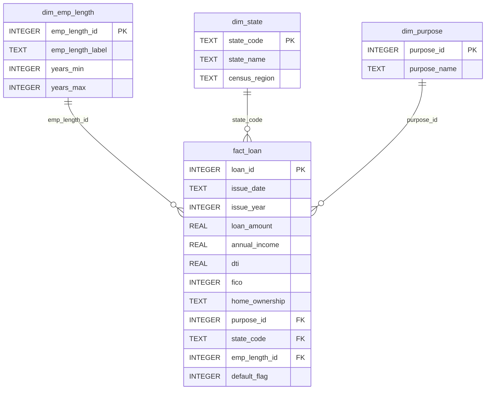

# Lending Club — analytical SQL over a star schema

Eight queries against 1,347,681 Lending Club loans (2007–2018), on a normalised
four-table SQLite schema. Python standard library only — no pandas, no driver,
no ORM. Every query here is one a credit-risk analyst would actually ask, and
each one exercises a specific technique rather than restating `SELECT *`.

The same dataset backs two other projects in this portfolio: a
[credit-risk model](https://github.com/jaclab23/credit-risk-modelling) in Python
and a Power BI portfolio dashboard. The default rates in Q8 here match the
dashboard's numbers to two decimal places, which is the point — three
independent implementations of the same calculation should agree.

---

## Schema

One fact table at loan grain, three conformed dimensions. Foreign keys are
enforced, so a fact row cannot reference a purpose or state that does not exist.



To see this from the database itself rather than the source file:

```bash
python inspect.py              # tables, columns, keys, row counts
python inspect.py --mermaid    # the diagram above, regenerated
python inspect.py --table fact_loan
```

Every join you will write starts from one of those three `FK` lines. `fact_loan`
is the big table (1,347,681 rows); the three `dim_` tables are small lookups
(51 states, 14 purposes, 12 employment bands) that turn integer codes into
readable labels.

Two modelling decisions worth calling out, because they are the difference
between a schema that answers questions and one that quietly lies:

**Employment length keeps its NULLs.** The source stores it as text — `"10+ years"`,
`"< 1 year"`, `"NI"`. The dimension resolves each label to a numeric band so it
sorts and aggregates, but `"NI"` means *not indicated*, which is a missing
answer rather than a short tenure. Both bounds stay `NULL`. Treating it as zero
would bias every employment cut, and Q2 measures exactly how much.

**The state dimension carries reference data, not loan data.** `state_name` and
`census_region` come from the US Census Bureau, so the loader only inserts codes
it actually saw in the file. The dimension never claims coverage the data does
not have, and the loader fails loudly if a state code has no reference row.

---

## The queries

| # | Question | Technique |
|---|----------|-----------|
| Q1 | Which region × purpose combinations carry real risk? | Three-table `INNER JOIN`, `GROUP BY`, `HAVING` on a volume floor |
| Q2 | What are the missing employment-length answers hiding? | `LEFT JOIN`, `IS NULL` semantics, `COALESCE` |
| Q3 | Which purposes beat the portfolio default rate? | Scalar subquery inside `HAVING` |
| Q4 | How do states rank *within* their own region? | `RANK() OVER (PARTITION BY … ORDER BY …)` |
| Q5 | How did volume build, and when had we written half the book? | `SUM() OVER (ORDER BY … ROWS UNBOUNDED PRECEDING)` |
| Q6 | What is the underlying default trend under monthly noise? | Sliding-frame `AVG() OVER (ROWS BETWEEN 2 PRECEDING …)`, `LAG()` |
| Q7 | Top three purposes by volume in each region? | CTE, `ROW_NUMBER()` partitioned, window `SUM()` for share |
| Q8 | Default rate by FICO band × home ownership? | `CASE` bucketing, conditional aggregation as a pivot |

---

## Results

Run against the full 1,347,681-row extract.

Ordered by strength of finding rather than by question number: the cross-check
first, then the three findings, then the two that demonstrate technique. Q4 and
Q7 return long tables and are omitted here; `results-full.txt` has the complete
output of all eight.

### Q8 — the cross-check that matters

```
fico_band  | loans  | default_rate_pct | rate_mortgage | rate_rent | rate_own
-----------+--------+------------------+---------------+-----------+---------
1. < 680   | 460605 | 25.30            | 22.68         | 27.69     | 25.98
2. 680-699 | 361910 | 21.45            | 19.09         | 24.15     | 21.70
3. 700-719 | 246591 | 17.30            | 15.40         | 19.74     | 18.41
4. 720-739 | 133283 | 13.81            | 11.93         | 16.51     | 15.22
5. 740-759 |  68308 | 11.15            |  9.21         | 13.90     | 12.80
6. 760+    |  76984 |  8.32            |  6.40         | 11.20     | 10.91
```

The band counts sum to exactly 1,347,681 and the default rates match the Power BI
dashboard's risk-segment page to two decimal places. Same inputs, same
definitions, same answer from a different engine.

The `RENT` column is the interesting one: at every FICO band, renters default
more than mortgagors by 4–5 points. FICO does not fully capture it.

### Q2 — missingness is informative

```
emp_length | loans  | pct_of_portfolio | default_rate_pct
-----------+--------+------------------+-----------------
10+ years  | 442667 | 32.85            | 18.80
2 years    | 122091 |  9.06            | 19.82
< 1 year   | 108517 |  8.05            | 20.54
3 years    | 107862 |  8.00            | 19.99
1 year     |  88841 |  6.59            | 20.59
5 years    |  84326 |  6.26            | 19.62
4 years    |  80761 |  5.99            | 19.76
NI         |  78188 |  5.80            | 26.96   ←
6 years    |  62877 |  4.67            | 19.38
8 years    |  60808 |  4.51            | 19.95
7 years    |  59724 |  4.43            | 19.51
9 years    |  51019 |  3.79            | 19.91
```

Every stated tenure band sits between 18.8% and 20.6%. The borrowers who
declined to answer default at **26.96%** — nearly seven points above the book,
across 5.8% of it. The missingness is not random and it is not harmless; it is
one of the stronger single predictors in the dataset, and it would vanish
entirely if `"NI"` had been coerced to zero.

### Q3 — small business is the outlier

```
purpose_name       | loans  | default_rate_pct | pts_vs_portfolio
-------------------+--------+------------------+-----------------
small_business     |  15575 | 29.86            | +9.88
moving             |   9520 | 23.41            | +3.44
house              |   7294 | 21.91            | +1.93
medical            |  15606 | 21.84            | +1.87
debt_consolidation | 781206 | 21.15            | +1.18
other              |  78263 | 21.08            | +1.11
```

`small_business` defaults at 29.86% against a 19.98% book — and at 15,575 loans
that is far too large to be noise. It is also the second-smallest purpose by
volume bar two, which is why the `HAVING COUNT(*) >= 5000` floor matters: without
it, a category with 40 loans would sit at the top of this list on pure variance.

### Q1 — region and purpose together

The top of the table is `debt_consolidation` in three of four regions, between
19.9% and 21.8% — except the West, where `other` leads at 20.62% and
debt_consolidation sits at 19.89%. The cleanest signal is at the bottom:
`credit_card` loans default at 15.9% in the West against 17.8% in the
Northeast, and `home_improvement` at 15.0% in the West against 19.2% in the
Northeast. Region is doing real work inside a purpose, which is why Q4 partitions
by it rather than ranking nationally.

The floor is also visible in what it removed. Drop the 10,000-loan threshold and
the top four rows are all four regions of `small_business`, which never reaches
that volume in any single region. The filter makes the table actionable and
deletes a consistently high-risk category from it at the same time; both are
true, and the query comment says so.

### Q5 — volume

Origin­ations run from June 2007 to December 2018 across 139 months. Cumulative
volume reaches 100% at 1,347,681 loans in December 2018:

```
2018-11-01 | 1627 | 22.5 | 1346436 | 99.9
2018-12-01 | 1245 | 17.2 | 1347681 | 100.0
```

The window function makes the "when did we write half the book" question a
single pass rather than a correlated subquery per row.

### Q6 — trend, with the censoring caveat it needs

The three-month moving average smooths the monthly series, and `LAG` gives
direction. The important caveat is written into the query comment rather than
left implicit: **late vintages have not had time to default**, so the series
falls away at the end of the range. That is censoring, not improving credit
quality, and reading it the other way is the standard mistake with this dataset.

---

## Running it

```bash
# 1. build the star schema from a CSV extract
python build_db.py --source sample/loans_sample.csv --db lending_club.db

# 2. work through the exercise sheet
#    (see exercises.md - twenty graded tasks with a self-checker)

# 3. check one answer
python check.py --exercise 8 --file answers/e08.sql

# 4. prove the checker still rejects the known cheats
python check.py --guards

# 5. write the eight questions in queries.sql, then check their shape
python check_queries.py
```

`sample/loans_sample.csv` is a fixed 100,000-row draw (seed 42) from the full
extract, so the repository runs end to end without the 160 MB original. The
figures in *Results* above are from the full 1,347,681 rows.

Note that the `HAVING` thresholds are tuned for the full dataset. On the sample,
Q1's 10,000-loan floor drops it to 3 rows and Q4's 1,000-loan floor to 28
states — the SQL is unchanged, the sample is simply 7% of the size.

Python 3.10+ and the standard library. No other dependencies.

### Files

```
schema.sql              the four tables, keys, checks and indexes
build_db.py             CSV → SQLite loader, single transaction, integrity checks
exercises.md            twenty graded exercises, blocked by skill
check.py                self-checker: pass/fail per exercise, never shows the answer;
                        compares result sets, plus table-read and mutation guards
                        on the exercises where a lucky wrong answer would pass
check_queries.py        shape checker for the eight questions: column count, row
                        count, grain, ordering and internal consistency, no
                        reference SQL inside it
inspect.py              prints the schema, keys and relationships on demand
answers/                your queries, one file per exercise
queries.sql             your final eight-question analysis
solutions/              reference answers - open only after the exercises
run_queries.py          executes a .sql file and prints result sets
make_sample.py          regenerates sample/loans_sample.csv (seed 42)
results-full.txt        complete output of the reference set on the full dataset
sample/loans_sample.csv
```

`lending_club.db` is not committed — it is derived and rebuildable in about
40 seconds.

---

## What I would do next

The obvious gap is that this is descriptive. Q2's finding — that `"NI"` carries
a seven-point default premium — is a feature-ranking result, and the natural
follow-up is to test whether it survives controlling for FICO and DTI, which is
what the separate credit-risk model does in Python. Joining the two would let
the SQL set serve the model rather than run beside it.
